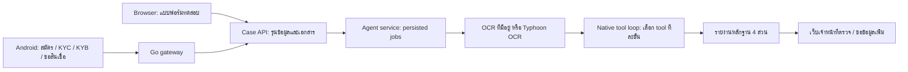

# ทดลอง Agent service และเว็บเจ้าหน้าที่

ระบบรับข้อมูลได้สองทาง: แบบฟอร์ม browser สำหรับทดสอบสังเคราะห์ และ Android
ผ่าน Go gateway เดิม ทั้งสองส่งงานเข้า Agent review service เดียวกัน เว็บเจ้าหน้าที่
แสดงหลักฐาน รายงาน 4 ส่วน คำถาม และผลพิจารณาของคน



Orchestrator เป็น custom controller: ตรวจ input/schema/evidence ด้วยโค้ดก่อน
แล้วให้โมเดลเลือก tool ตามสถานะและหลักฐานที่อ่านมา ทำงานทีละ tool พร้อม
validation, observations และเพดานการเรียก ไม่ใช่ parallel multi-agent และยังไม่ได้ใช้
LangGraph ส่วน Offline ข้าม LLM โดยตรง ใช้ตัวสร้างรายงานจาก OCR ที่ส่งมาเท่านั้น

## เริ่มแบบ browser

จาก repository root ใช้ Python 3.12 ขึ้นไป:

```powershell
python -m venv .venv
.\.venv\Scripts\python.exe -m pip install -e './agent_app[dev]'
.\.venv\Scripts\python.exe agent_app/run_demo.py
```

Workspace ที่มี Merchant tooling ให้ source `scripts/project-env.ps1` ก่อน
คำสั่ง tooling ข้อมูลอยู่ใน `outputs/agent-demo/`; launcher สร้าง service token
ในเครื่องและส่งผ่านไฟล์ให้สอง process โดยไม่ส่ง token ไป browser

- แบบฟอร์ม: <http://127.0.0.1:8770/test-application>
- เจ้าหน้าที่: <http://127.0.0.1:8770/>
- Agent health: <http://127.0.0.1:8781/healthz>

กรอกชื่อและข้อมูล → ยืนยัน consent → สร้างเคส → เพิ่ม bundled PDF ตัวอย่าง →
เลือก Offline → เริ่มงาน → เปิดเคสในพื้นที่เจ้าหน้าที่ ตัวอย่างระบุชื่อ `Mali Jaidee`
และเป็นข้อมูลสังเคราะห์ รายงานจะไม่ถือ memo ว่า sales เป็นหลักฐานยืนยันยอดขายทันที

ไฟล์ที่อัปโหลดเองต้องเลือก Typhoon หากยังไม่มี OCR บริการไม่เอาไฟล์ตัวอย่าง
มาแทนไฟล์ผู้ใช้ หากต้องใช้ provider ให้ระบุไฟล์ environment ที่มี
`TYPHOON_API_KEY` โดยไม่ใส่ key ในคำสั่งหรือ commit:

```powershell
.\.venv\Scripts\python.exe agent_app/run_demo.py --env-file <path-to-env-file>
```

Launcher ปฏิเสธ port ที่มีคนใช้อยู่ ใช้ `--staff-port`, `--agent-port`, `--state-dir`
เพื่อแยกรอบทดสอบ กด Ctrl+C เพื่อหยุดสอง process ที่ launcher นี้เริ่มไว้
ใช้ `--check` เพื่อตรวจ startup/health แล้วปิดเฉพาะ process ของรอบนั้น

## เชื่อม Android / Go

ใช้ Go/Flutter จาก Merchant checkout ที่มี onboarding/lending contract ตาม
[integration contract](../docs/merchant_lending/onboarding-integration-contract.md)
แอปนี้ไม่ได้บรรจุ Go binary, PostgreSQL หรือ Flutter APK มาใน package Python

1. Go ตั้ง `LENDING_SERVICE_URL=http://127.0.0.1:8770` และ bridge token
   จากไฟล์ส่วนตัว ใช้ token เดียวกับ Case API ไม่ใช่ Agent service token
2. Case API อ่านธนาคารผ่าน named roles `lending-agent` และ `lending-reviewer`
   จากไฟล์ที่ฝั่ง server ถือไว้ เปิด launcher ด้วย arguments เพิ่ม:

```powershell
.\.venv\Scripts\python.exe agent_app/run_demo.py --env-file <provider-env-file> `
  --bank-url http://127.0.0.1:18082 `
  --bank-agent-key-file <agent-role-key-file> `
  --bank-reviewer-key-file <reviewer-role-key-file> `
  --bridge-token-file <go-case-api-bridge-token-file>
```

3. Android ชี้ Go API ตาม configuration ของแอป เช่น emulator ใช้
   `http://10.0.2.2:18082` จากนั้นสมัคร/KYC/KYB/แนบเอกสาร/กดส่งตรวจตาม flow เดิม
   Browser จะเห็นเคส `source=merchant_app` และ job ของ Agent service

Android submit ใช้ Typhoon เป็นค่าเริ่มต้น สามารถระบุ `--agent-review-mode offline`
สำหรับ synthetic acceptance ที่ทุกเอกสารมี OCR อยู่แล้วเท่านั้น เอกสารไม่รู้จัก
จะ fail ชัดเจนและไม่มี OCR/LLM fallback แอบทำงาน

รุ่นข้อมูล เอกสาร policy และเจ้าของบัญชีผูกกับ snapshot เดิม การเปลี่ยนสถานะ
PROCESSING → รอเจ้าหน้าที่ ไม่ทำให้รายงานล้าสมัย แต่การเปลี่ยน input/เอกสาร/รุ่น
ทำให้ผลเก่าล้าสมัย การยื่นเดิมซ้ำใช้ receipt เดิมและไม่เริ่ม Agent อีกครั้ง

## สถานะงานและการกู้คืน

API ภายใน Agent service ใช้ Bearer token อย่างน้อย 32 ตัวอักษร:

| Method | Path | ผล |
|---|---|---|
| GET | `/healthz` | liveness |
| GET | `/readyz` | โหมดที่ตั้งค่าไว้ ไม่เผย key |
| POST | `/v1/reviews` | รับ `{case,documents,mode,idempotency_key}` แล้วคืน job |
| GET | `/v1/reviews/{job_id}` | งานที่ระบุ |
| GET | `/v1/cases/{case_id}/review` | งานล่าสุดของเคส |

คิวจำกัดขนาดและทำงานหนึ่ง worker ต่อ SQLite database งานมีสถานะ QUEUED,
RUNNING, COMPLETED, FAILED, INTERRUPTED การ restart จะเปลี่ยน RUNNING เป็น
INTERRUPTED และไม่เรียก provider ซ้ำอัตโนมัติ ห้ามเปิดหลาย instance ทับ DB เดียวกัน

เมื่อคำสั่งขาดการตอบกลับ ปุ่มกู้คืนจะส่ง key/body เดิม ห้ามลบ pending command
เพื่อเริ่มใหม่จนกว่าจะตรวจ receipt เดิม โดย Android dispatcher เก็บ key/job binding
ไว้ในเคส หากรอเกินเพดานให้ดูงานเดิม ไม่ถือว่าอนุมัติหรือไม่ผ่าน

COMPLETED หมายถึง service ประมวลผลเสร็จ หาก `review_state=TECHNICAL_REVIEW`
เว็บจะแสดงว่าตรวจไม่ครบ ผลอาจมีหลักฐานบางส่วน ต้องดูทั้งสองสถานะ Logs และ
SQLite ของ launcher อยู่ใน `--state-dir`; trace/usage อ่านจากประวัติงานในเว็บ

## กู้คืน receipt ของ Android อย่างชัดเจน

เมื่อ Android dispatch อยู่ใน SUBMITTING / QUEUED / RUNNING หรือเกิด transport uncertainty / POLL_LIMIT
Case API จะเก็บ **body เต็มเดิม**, mode, key, snapshot, เอกสาร และ job ID ที่ทราบไว้ก่อนเรียก service
การส่ง submit ด้วย key ใหม่ การแก้ไขข้อมูล และการเพิ่ม/ลบเอกสารจะถูกปฏิเสธด้วย
`evidence_dispatch_unresolved` จนกว่าจะตรวจผลเดิม การ replay submit เดิมยังคืน receipt เดิมโดยไม่เริ่ม worker ใหม่
การเปิด service ใหม่ไม่ resubmit งานอัตโนมัติ

เจ้าหน้าที่เปิดเคสใน browser แล้วกด **กู้คืนงาน Android ด้วยคำสั่งเดิม** เมื่อเคสอยู่ TECHNICAL_REVIEW
ปุ่มเรียก `POST /api/cases/{case_id}/evidence-review/recover` พร้อม `X-Review-Nonce` และ JSON:

```json
{"version": 2, "revision": 11, "mode": "typhoon", "idempotency_key": "<original-service-key>"}
```

ใช้ version/revision ปัจจุบันและ mode/key จาก `results.evidence_review` เท่านั้น
API ตรวจ owner, consent, snapshot และเอกสารเทียบกับ body ที่บันทึกไว้ แล้ว claim ด้วย CAS
และตอบ 202 เป็นเคส จากนั้น worker ส่ง **service body/key เดิมทุกค่า** ไป `/v1/reviews`
เพื่อคืน job เดิม หากการส่งครั้งแรกยังไม่ถึง service จะรับคำสั่งเดิมครั้งแรกจากการกดกู้คืนนี้
ไม่มีการหมุน key เพื่อสร้าง paid job ทดแทน ถ้าทราบ job ID แล้ว ผลต้องตรงกับ ID เดิม
mode, snapshot หรือ revision ไม่ตรงจะหยุดด้วย `evidence_recovery_mismatch` โดยเก็บ binding เดิมไว้
หาก receipt เก่าไม่มี body ที่บันทึกไว้ จะหยุดให้ตรวจสอบ ไม่สร้าง body ทดแทนจากการคาดเดา

หากคำตอบ API สูญหาย browser เก็บคำขอกู้คืนเดิมใน localStorage และปุ่มตรวจผลคำสั่งเดิม replay คำขอนั้น
request กู้คืนที่เคยรับแล้วคืนเคสล่าสุดและไม่เริ่ม worker อีก ผล COMPLETED ยังเป็นหลักฐานเพื่อให้คนพิจารณา
financial/assessment/decision คงเป็น null และคำตัดสินของคนไม่ถูกเขียนทับ
FAILED ที่ทราบแน่นอนอนุญาตให้ส่ง submit ใหม่อย่างชัดเจนได้; INTERRUPTED ยังต้องเก็บ binding เดิมและตรวจสอบ

trace แสดง `llm_attempt` หนึ่งรายการต่อ native call รวม terminal rejection พร้อม enum/count/status/token
ที่คัดกรองแล้ว ไม่ส่ง rejected content หรือ private reasoning; ถ้างานล้มหลัง OCR ยังเก็บ usage ที่ทราบ
และใช้ null เมื่อจำนวน token ของการเรียกที่ล้มเหลวไม่ทราบ

ทดสอบเฉพาะส่วนนี้โดยใช้ interpreter ของโครงการ, ตั้ง PYTHONPATH เป็น `agent_app/src`
และใช้ pytest basetemp ภายใต้ `outputs/`:

```powershell
python -m pytest agent_app/tests/test_review_api.py agent_app/tests/test_review_dispatch.py agent_app/tests/test_review_pipeline.py agent_app/tests/test_review_gateway.py agent_app/tests/test_review_service.py agent_app/tests/test_review_routes.py --basetemp outputs/review-recovery-tests
node --test agent_app/tests/staff_ui.test.cjs
```

ทั้งหมดใช้ synthetic data และ stub provider; ไม่ใช่ live/native semantic acceptance

## Container

มี image เดียวและสอง service พร้อม volume แยก case/agent ตั้ง
`AGENT_SERVICE_TOKEN` เป็น secret ใน environment แล้วรันจาก root:

```powershell
docker compose -f agent_app/compose.yaml up --build -d --wait
docker compose -f agent_app/compose.yaml down
```

ตัวอย่างเปิดเฉพาะ Case API บน loopback `8770` Agent service อยู่เครือข่ายภายใน
สามารถเพิ่ม `TYPHOON_API_KEY` ผ่าน secret environment ได้ ห้าม commit `.env`
CI ตรวจ build/start/health/assets/PDF renderer; ผล hosted CI ต้องตรวจที่ PR head
จริง เครื่องพัฒนาที่ไม่มี Docker engine ใช้ Python launcher ได้

## ส่วนที่ยังต้องทำให้ครบก่อนใช้งานสินเชื่อจริง

- แก้ semantic failures ที่เคยพบใน model scenarios แล้วทำ held-out acceptance
  ใหม่ รวม source grouping, การจัดเงินเข้าที่ไม่ยืนยันเป็นยอดขาย และ declaration
  ที่ข้อมูลไม่ครบ Tests ของ service ไม่ได้ทำให้ model scenarios เดิมผ่าน
- เชื่อมหลักฐานรายได้/ภาระหนี้และกฎกำลังชำระที่ทีมเครดิตรับรอง แยกจากรายงาน
  evidence-only ปัจจุบัน งานนี้ไม่มี financial approval packet จึงกดอนุมัติไม่ได้
- Workflow เพิ่มวงเงินยังต้องมี loan ledger, ประวัติงวด/ค้างชำระ/ชำระล่วงหน้า
  พร้อม context ปัจจุบัน ยังไม่ได้สร้างในงานนี้
- ก่อน production เพิ่ม staff SSO/roles, audit/retention, TLS, secret management,
  storage/queue ที่รองรับ deployment จริง และ recovery/reconciliation ระหว่างสอง DB
  ปัจจุบันเป็น local demo ที่มี service boundary พร้อมเตรียม deployment

ยังไม่ได้ deploy AWS และไม่จำเป็นต้องใช้ Bedrock เพื่อเรียก Typhoon จาก service นี้
