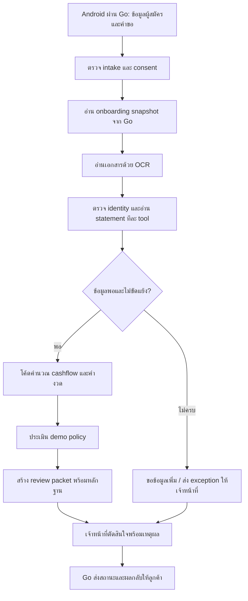
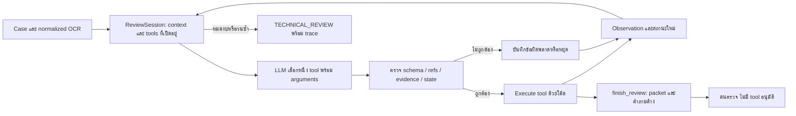

# สถานะ Agentic workflow สำหรับทีม — 24 ตุลาคม 2026

ตอนนี้มี **controller กลางคุมสถานะและสิทธิ์เรียก tool โดยทำงานทีละขั้น** แล้ว
ส่วน native agent ที่เลือกเครื่องมือจากหลักฐานและรับผลกลับมาเป็นรอบ ๆ ทำงานได้ใน
ชุดทดลอง local แต่ยังไม่ได้เสียบเข้าเว็บเจ้าหน้าที่ เส้นทางเว็บกับเส้นทางทดลองจึงต้อง
ตรวจแยกกัน ยังไม่ใช้ LangGraph/LangChain และไม่มี specialist agents ทำงานขนานกัน

PR นี้เผยแพร่ Python application ที่เดิมอยู่เฉพาะใน workspace ให้ทีม clone แล้วรันได้
โค้ดอยู่ใน `agent_app/` พร้อม tests, fixtures สังเคราะห์, adapters และตัวรันทดลอง
Go/Flutter อยู่ใน repository Merchant อีกชุด; PR นี้ไม่ได้รวม source ของสองส่วนนั้น

## เราทำแบบไหน

| ส่วน | รูปแบบการทำงานจริง | สถานะ |
|---|---|---|
| Staff API / Android integration | `LendingController` เป็น state machine; `allowed()` กำหนด tool ที่เรียกได้; planner เลือกหนึ่งตัว แล้ว controller execute/save ก่อนรอบถัดไป | มีใน server และ contract ฝั่ง Go |
| Native agent experiment | `ReviewSession` คุมหลักฐาน/tool schema; Typhoon หรือ OpenAI เลือก tool พร้อม arguments; validator ตรวจแล้วจึง execute และส่ง observation กลับ | รันผ่าน CLI; ยังไม่เชื่อมเข้า staff server |
| รายงาน statement 4 ส่วน | `build_staff_report` และ renderer ใช้โค้ดรวม ledger, refs, หลักฐานประกอบและคำถาม | มี module/CLI/tests; ยังไม่ต่อเข้าหน้าเจ้าหน้าที่ |

ดังนั้นคำอธิบายสั้น ๆ คือ **มี orchestrator แบบเขียนเอง และ execute tools แบบ sequential**
ตัว native loop มีความเป็น agentic ตรงที่โมเดลเลือกการตรวจครั้งต่อไปจาก context และผล
tool ก่อนหน้า แต่สิทธิ์ การคำนวณเงิน และเงื่อนไขส่งต่ออยู่ในโค้ด
การมีชื่อ tool หลายชื่อไม่ได้หมายความว่าแต่ละ tool เป็น LLM agent อีกตัว
มี background thread สำหรับส่งงานของเคสจาก HTTP แต่ไม่ได้เป็น parallel multi-agent

### เส้นทางที่เว็บ/แอปใช้อยู่ใน source

`server.py` สร้าง `LendingController` และ `Reviews`; คำขอจาก Merchant เรียก
`TyphoonPlanner` ใน background thread ส่วน `/lab` เลือก baseline หรือ Typhoon ได้
Planner เดิมเรียก native tools อยู่แล้ว แต่ arguments มีเพียง `reason`;
รุ่นทดลองเพิ่ม arguments เชิงหลักฐาน เช่น refs, claims และ findings
Baseline เป็นตัวเลือกแบบ deterministic สำหรับตรวจระบบโดยไม่เสียค่า API
ไม่ใช่โมเดลเครดิตสำรอง และไม่ใช่ native review loop รุ่นทดลอง

Onboarding/KYC และตัวตนจากเอกสารเป็นการตรวจตาม contract/provider ที่ตั้งค่าไว้
ผล demo ที่ใช้ mock ไม่ใช่การรับรองว่าต่อบริการ KYC จริงแล้ว
ผล `RECOMMEND_APPROVE` ใน packet เป็นข้อเสนอ; คำตัดสินสุดท้ายต้องมาจากเจ้าหน้าที่

### เส้นทาง native agent ที่กำลังทดลอง

จำกัดปกติ 8 model calls / 240 วินาทีต่อเคส, HTTP timeout ไม่เกินเวลาที่เหลือและ
45 วินาที มีการจำกัดการแก้ malformed response และหยุดเมื่อทำซ้ำโดยไม่มีหลักฐานใหม่
Timeout เป็นแบบ cooperative; ไม่ได้พิสูจน์ว่าหยุด network ของ OS ได้ทันที

| Tool ใน native loop | ทำอะไร |
|---|---|
| `read_transactions` | อ่านรายการพร้อม refs |
| `match_transfers` | ตรวจคู่โอนสองขาโดยใช้วัน จำนวน บัญชี และเจ้าของ |
| `compare_declarations` | เทียบคำแจ้งยอด/บัญชีกับหลักฐานและตรวจส่วนที่ยังตีความไม่ครบ |
| `propose_findings` | เสนอชนิดรายการหรือคำถามโดยอ้าง quote/refs; ไม่ยืนยัน UNKNOWN เป็นรายได้ |
| `flag_transactions` | เปิดข้อสงสัยและกักรายรับที่เกี่ยวข้อง; ผลข้างเคียงนี้ยังเป็นประเด็นต้องแก้ |
| `inspect_cashflow` | คำนวณรายเดือนด้วยโค้ดตาม policy |
| `finish_review` | ส่งหลักฐานและคำถามให้คน โดยคง `decision=null` |

OCR อยู่ก่อน native loop ในการทดลอง: ใช้ OCR replay/ข้อมูลสังเคราะห์ที่ตรึงไว้
จึงไม่ควรเรียกผลทดลองชุดนี้ว่า end-to-end live OCR acceptance
Trace เก็บ tool, arguments, เหตุผลสั้น, refs, observations และ token usage;
ไม่ได้เก็บความคิดภายในของโมเดล

## ทำถึงไหน และอะไรยังไม่ผ่าน

ผลต่อไปนี้เป็นผล historical snapshot วันที่ 23 ต.ค. ตรวจจาก saved reports
การจัดโฟลเดอร์และการเปิด PR รอบนี้ไม่ได้เรียกโมเดลใหม่หรือแก้คะแนนเดิม

| ชุดทดลอง | ผล | การอ่านผล |
|---|---|---|
| Typhoon native V4: C01–C18 | 8 PASS / 1 PARTIAL / 9 FAIL | มีทั้ง native schema error, ตรวจ refs ไม่ครบ และ flag เกินเหตุ |
| Typhoon V4: H01–H04 | 3 PASS / 1 FAIL | H01 นับเงินขายอุปกรณ์ที่เข้าซ้ำเป็นรายได้ประจำก่อนตรวจที่มา |
| OpenAI Luna รอบเลือกเคสค้าง 11 เคส | 8 PASS / 2 PARTIAL / 1 FAIL | C11 ยังไม่ขอ statement บัญชีที่สองตามเกณฑ์; C05/C08 ติดข้อจำกัดคำถามของ evaluator |
| รายงาน 4 ส่วน: Typhoon 7 เคส | 0 PASS / 7 FAIL | คะแนนรวม controller + model + report + evaluator |
| รายงาน 4 ส่วน: Luna 7 เคส | 2 PASS / 5 FAIL | C11/H01 ผ่าน; S04 หยุดก่อนครบงานเพราะ token budget |

ผล Luna ไม่ใช่การเปรียบเทียบความสามารถโมเดลอย่างเดียว เพราะ transport/history/context
ต่างกัน และชุด 7 เคสเน้นปัญหาที่เลือกมา ไม่ใช่การทดสอบความแม่นยำบนลูกค้าจริง
ผล fail ไม่ใช่คำตัดสินว่าผู้กู้มีเครดิตไม่ดี

ช่องว่างที่ควรแก้ก่อนรวมเข้าเว็บ:

1. แยก **ขอหลักฐานเพิ่ม** ออกจาก **กักยอดรายรับ**: ตอนนี้ `flag_transactions`
   ใช้ทั้งสองหน้าที่ ทำให้บางคำถามตัดยอดที่ไม่ควรถูกตัดออกจาก cashflow
2. ส่งคำถามต้นฉบับพร้อม refs ให้ครบถึง renderer: บางเคส JSON/trace มีคำถามเฉพาะ
   แต่ report builder แทนด้วยข้อความทั่วไป แล้ว Markdown แสดงเฉพาะ sections นั้น
3. ให้ orchestrator ตรวจครบทุกมิติและทุกกลุ่มเงินรับก่อนคำนวณ; เงินเข้าซ้ำไม่ได้
   พิสูจน์ว่าเป็นยอดขาย และข้อมูลที่ขาดต้องคง UNKNOWN
4. แก้ native protocol reliability และ guard ภาษา: substring เคยปฏิเสธคำว่า
   “ไม่อนุมัติสินเชื่อ” ทั้งที่เป็นข้อความปฏิเสธการอนุมัติ
5. ประเมินคำถามด้วย refs/หัวข้อ/หลักฐานที่ต้องขอ แยกจาก exact wording และยังให้คน
   ตรวจความหมายที่คลุมเครือ
6. รายงานตรวจ continuity ข้ามเอกสารได้ แต่ controller เดิมยังไม่บังคับ gate นี้
   มี strict XFAIL คงไว้เพื่อแสดง requirement ที่ยังไม่ผ่าน
7. ยังมีข้อค้างของ runner/evaluator สำหรับตรวจ batch coverage/completion,
   ความสอดคล้องของ usage และการผูก receipt ในกรณี replay; รอบที่รายงานมีไฟล์ครบ
   แต่ไม่ได้แปลว่า guard ครอบคลุมทุกกรณีในการรันครั้งถัดไป

รายงาน 4 ส่วนต้องใช้ corroboration ที่แอปเป็นเจ้าของและผูกกับรายการ/จำนวนเงิน
ก่อนนับเป็นยอดขายที่มีหลักฐาน ค่า supported sales เป็นศูนย์เมื่อไม่มี corroboration
จึงหมายถึง **ยังพิสูจน์ไม่ได้** ไม่ได้หมายความว่าร้านไม่มีรายได้

## สินเชื่อครั้งแรกกับเพิ่มวงเงิน

งานที่มีอยู่เป็น intake/review สำหรับคำขอสินเชื่อครั้งแรกหรือการแก้ข้อมูลคำขอเดิม
ยังไม่มี workflow เพิ่มวงเงินจากประวัติชำระ และการ revise case ไม่ใช่ top-up workflow
คะแนนใน demo เป็น rule score ตาม `demo_parameters.json`; ไม่ได้เรียกเครดิตบูโร
และไม่ใช่คะแนนจากโมเดล UCI/TabPFN ที่อยู่ใน research package

งานเพิ่มวงเงินรอบถัดไปควรมี contract ของ repayment ledger ก่อน ได้แก่ วันครบกำหนด
จำนวนที่ต้องจ่าย วันที่/จำนวนที่ชำระจริง ยอดคงค้าง การจ่ายบางส่วน วันค้างชำระ
รายการคืน/ยกเลิกการจ่าย การปรับโครงสร้าง และจำนวนงวดที่มีประวัติจริง พร้อม statement
ล่าสุด ภาระหนี้อื่น และความสามารถรับค่างวดรวม หลังจากนั้นจึงออกแบบกฎเลือกการตรวจเพิ่ม
และส่งเจ้าหน้าที่ตัดสินใจ การจ่ายเร็วอย่างเดียวไม่ควรเป็นหลักฐานอัตโนมัติให้เพิ่มวงเงิน
ส่วนนี้เป็นแผนงานใน [initial/limit review](INITIAL_AND_LIMIT_REVIEW_TH.md)

## สิ่งที่ทีมได้จาก PR และวิธีลอง

ดู [คู่มือแอป](../../agent_app/README.md) สำหรับ Python-only fresh clone, `/lab`,
baseline และการตั้งค่า bridge กับ Go ต้องใช้ Python 3.12 ขึ้นไป
เริ่มจาก baseline และ synthetic fixtures ได้โดยไม่มี API key

ผลตรวจจาก checkout ที่เตรียมส่ง PR ซึ่งไม่มี historical outputs:

- Python รวม: **530 passed / 15 skipped / 1 known strict XFAIL / 0 failed**
- JavaScript staff UI: **14 passed**; แก้หนึ่ง path ใน test ที่เคยพึ่ง local junction
- Ruff lint และ format ผ่าน; source ทางการเงินและ provider settings ไม่เปลี่ยน
- 15 skips เป็น replay tests ที่ไม่มีชุดผลทดลองเดิมใน Git; ถ้ามี bundle แต่เสีย/ขาด
  tests จะ fail ส่วน workspace ผู้ทดลองที่มี bundle ครบเคยผ่าน 545 + 1 XFAIL

ผล tests เหล่านี้พิสูจน์ code contracts/การรันซ้ำแบบ offline ไม่ได้แทนผลโมเดลในตารางบน
ยังไม่ได้ deploy AWS หรือทดสอบ durable multi-worker/restart ของ native loop
งาน shell เก่าที่ถูกยกเลิกหลัง T3 restart ไม่จำเป็นต่อการเปิด PR นี้ จึงไม่เริ่มบริการ/DB
เดิมซ้ำ ไม่ถือว่าบริการเดโมกำลังทำงานอยู่เพียงเพราะเคยเปิดไว้

## จุดอ่าน source และหลักฐาน

- [HTTP server](../../agent_app/src/merchant_sandbox/server.py), [controller](../../agent_app/src/merchant_sandbox/lending.py), [core state machine](../../agent_app/src/merchant_sandbox/core.py)
- [native review loop](../../agent_app/src/merchant_sandbox/agentic_review.py), [Typhoon adapter](../../agent_app/src/merchant_sandbox/agentic_typhoon.py), [OpenAI adapter](../../agent_app/src/merchant_sandbox/agentic_openai.py)
- [four-part report](../../agent_app/src/merchant_sandbox/statement_report.py), [onboarding/reviewer contract](onboarding-integration-contract.md)
- ผล historical: [V4](LOCAL_AGENTIC_EXPERIMENT_RESULTS_TH.md), [Luna เคสค้าง](OPENAI_LUNA_FAILED_CASES_TH.md), [รายงาน 4 ส่วน](STATEMENT_FOUR_PART_RESULTS_TH.md)

เอกสาร historical มีลิงก์ `outputs/` ซึ่งเป็น artifacts ในเครื่องผู้ทดลองและไม่รวมใน Git
ให้ใช้ชื่อ snapshot และ hashes ใน [evidence summary](TEAM_AGENTIC_EVIDENCE_20261024.json)
เพื่อระบุรอบอย่างถูกต้อง ไม่อ้างว่าทีม clone แล้วได้ผล live เดิมทันที
